<p align="center">
  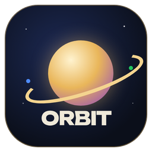
</p>

<h1 align="center">The Daily Orbit</h1>

<p align="center"><b>A newspaper that learns you, not one that sells you.</b></p>

<p align="center">
  Your own daily paper for Windows: World, India, Finance, Technology, Science, Sports, Astronomy, Health and Entertainment.<br>
  Free. No account. No ads. It learns your taste on your laptop, and proves that nothing about you leaves it.
</p>

<p align="center">
  
  
  
  
  
</p>

<p align="center"><b><a href="https://vishal-1211.github.io/dailyorbit/">🌐 See the website</a></b></p>

<p align="center"><i>Built at the Claude Build Day, Mumbai (10 Oct 2026), with Claude Code.</i></p>

<p align="center">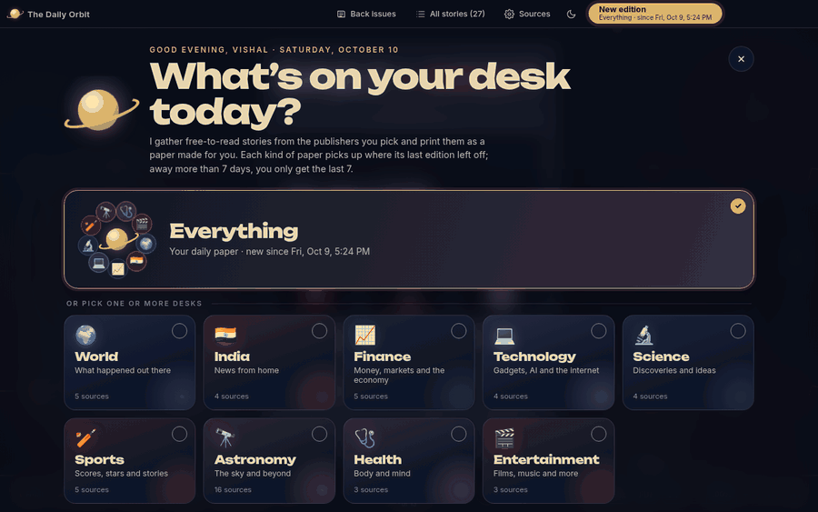</p>

## In 60 seconds

1. **Pick your paper.** *Everything*, or any mix of nine desks.
2. **Press Print.** It reads about 70 free publishers and lays out a real newspaper in seconds: front page, sections, quiz, memes, back page.
3. **Read, listen or save.** Turn the pages, press **▶ Briefing** to hear the top five stories, or save the whole paper as a PDF.
4. **It learns.** Open what you like, tap 👍 or 👎. Tomorrow's paper is more yours.
5. **Check the receipt.** The **You & your paper** page shows what it learned and **every site it contacted**, with proof that nothing about you was sent.

No internet right now? Press **Demo paper (offline)** on the newsstand.

## Why it wins your trust

**A newspaper that learns you, not one that sells you.** Most news apps learn what you read so they can keep you scrolling and sell your attention. The Daily Orbit learns what you read so it can print you a better paper, and that knowledge never leaves your laptop.

| | The Daily Orbit | Typical news apps and aggregators |
|---|---|---|
| Who learns your taste | Your own laptop | The company's servers |
| Account / sign-in | None | Usually required |
| Ads, trackers, cookies | None | Common |
| Cost | Free, no subscription, no paid AI | Free with ads, or paid |
| Works offline | Yes: read every saved paper, plus a demo paper | Mostly online only |
| Shows you what it sent | Yes: a receipt page in every paper | No |
| Paywalled stories | Detected and skipped | Often shown, then blocked |
| Format | A designed newspaper with pages, sections and an ending | An endless feed |

**What you get**

- **Calm by design.** A paper has a front page and a back page. You finish it. No infinite scroll, no notifications, no autoplay.
- **Fast.** A full Everything paper from about 50 publishers is ready in seconds (about 22 s in our slow-network benchmark), and a second paper the same day reuses what it already read.
- **Personal across topics.** One on-device model learns from every desk. Read the money pages and Finance moves up in every paper; skip cricket and it shrinks, but never disappears. About one story in five is deliberately something different, so it doesn't trap you in a bubble.
- **Transparent.** "Why this?" explains why any story was picked; the taste chart shows what it has learned; "Check the model now" tests it; one button erases it.
- **Private, provably.** The reading windows cannot reach the internet at all. Publishers see a generic reader with no cookies, no IDs, no referrer. Every story in the date window is fetched, not just the ones you like, so even the requests reveal nothing about your taste. Pictures are saved when the paper is printed, so reading makes no requests. Optional Tor routing. The "What left your laptop" page lists every site contacted.
- **Made for India and the world.** World and India desks side by side, Indian and global publishers, cricket next to football and F1, Sensex next to the Fed, and a sky page for your own city.
- **More than headlines.** Full articles in a book-style reader, a quiz built from the week's stories, did-you-know facts, Page 3 people, home-made memes, and the same story from every publisher side by side.
- **Listen.** "▶ Briefing" reads the top five stories aloud in about two minutes, and any story can be read aloud, using only the voices on your computer.
- **Keep it.** Save any paper as a PDF; back issues stay on your laptop.
- **Yours to shape.** About 70 free sources ready to go, any RSS feed or website can be added, nine desks you can mix in any combination, night and day paper, zoom, fit-to-width and continuous reading.
- **Open source, MIT licence.** Read every line of what runs on your machine.

## Made for everyone

News should be easy to take in, whatever your eyes, your connection or your budget.

- **Listen instead of read.** **▶ Briefing** reads the edition's top five stories aloud in about two minutes. **🔊 Listen** reads any full story. Both use only the voices built into your computer, so they work offline and never send the text anywhere. Helpful for people with low vision or blindness, people with dyslexia, and anyone cooking breakfast.
- **Big, clear type.** Zoom up to 250%, larger or smaller type (A− / A+), and fit-to-width mode for one large page with big text. Night paper (light text on dark) and day paper (dark text on cream) for comfortable contrast.
- **Keyboard first.** ← / → turn pages, ↑ / ↓ move around a page, Home / End jump to the start or end, Esc goes back. Pages never turn by accident: no swipes, no scroll-to-turn.
- **Calm reading.** No autoplay, no pop-ups, no notifications, no infinite feed. Continuous reading mode shows a whole story as one scroll.
- **Light on data and money.** Free forever, no subscription. Pictures are saved once when the paper is printed, back issues open offline, and a second paper the same day reuses stories it already downloaded. Good for slow or metered connections.
- **Plain language about itself.** Every choice the paper makes can be explained: "Why this?" on any story, a taste chart, a model check, and one button to erase what it learned.

Full screen-reader support and a high-contrast mode are next on the roadmap (see below).

## Who it's for

- **Busy professionals** who want the day's finance, tech and world news in one calm read, or as a two-minute audio briefing.
- **Students** who want news across subjects, with a quiz and context, without a social feed.
- **Older readers** who miss the shape of a real newspaper, and want big type and audio.
- **People with low vision or reading difficulties**, who can listen to the paper read aloud offline.
- **Privacy-conscious readers, journalists and researchers**, who don't want their reading tracked.
- **Families and schools**, who want news without ads, trackers or endless scrolling.

## By the numbers

| | |
|---|---|
| Desks (topics) | 9, each with its own sections |
| Free sources ready to use | about 70, 49 switched on |
| From click to paper | about 22 s for a full paper from 49 publishers (benchmark on a slow network); a second paper the same day is near-instant |
| Data sent about you | none: no account, cookies, IDs, location or reading history |
| Cost | 0: no subscription, no paid AI, no ads |
| Automated checks | learning, sky maths, layout at four screen sizes, page limits, privacy (identical requests whatever you read) and speed, on every change |


## A look inside

| | |
|---|---|
| 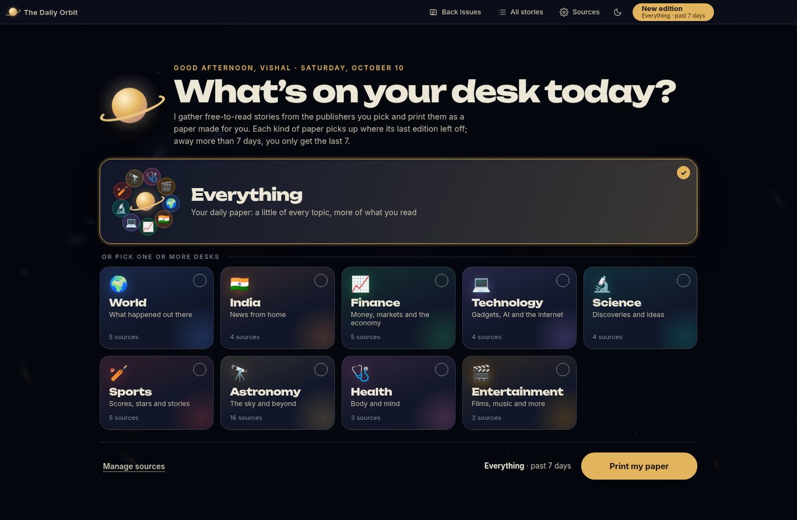 | 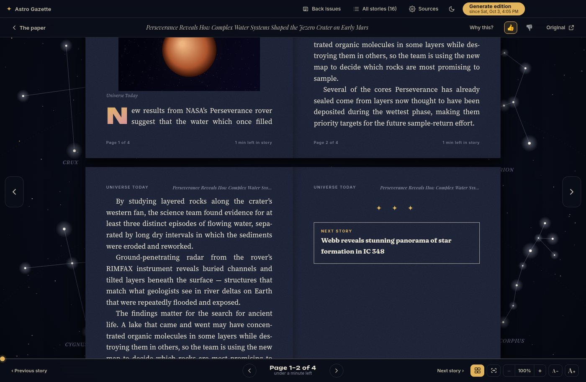 |
| 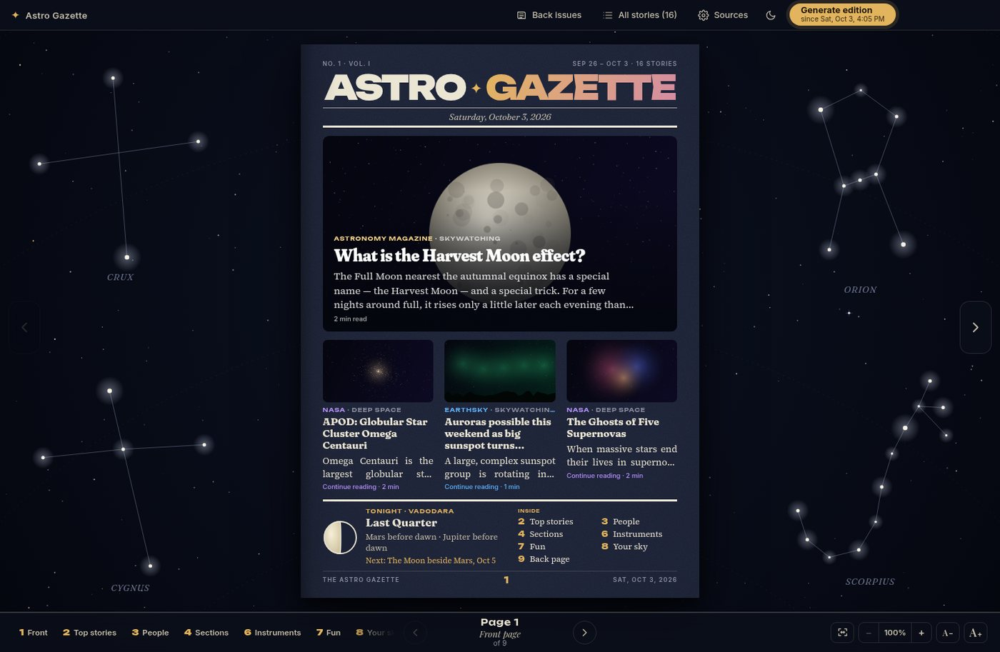 | 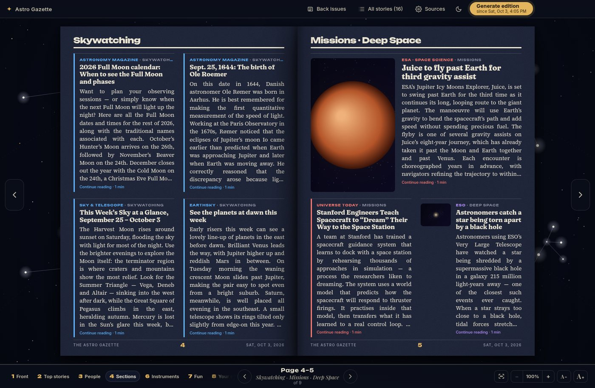 |
| 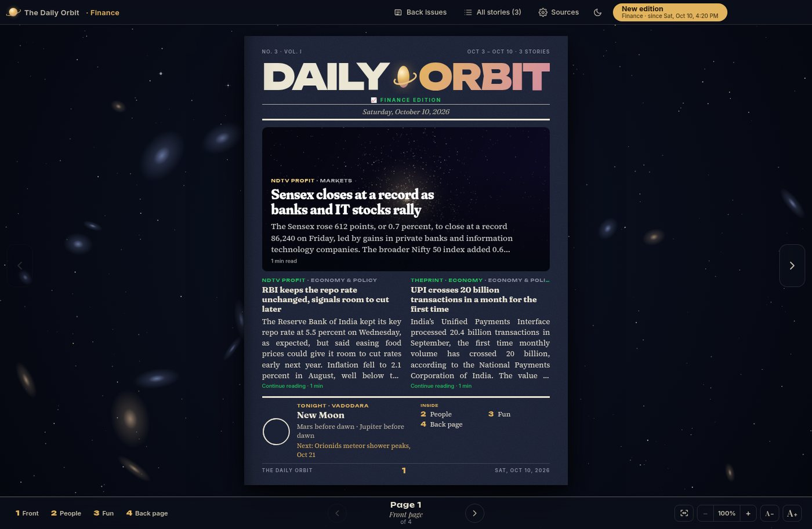 | 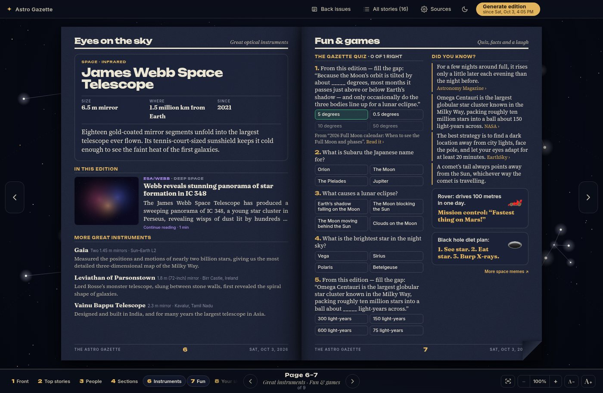 |
| 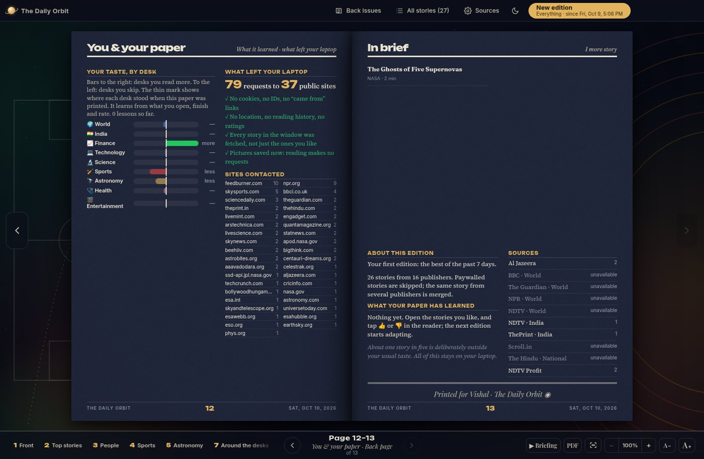 | 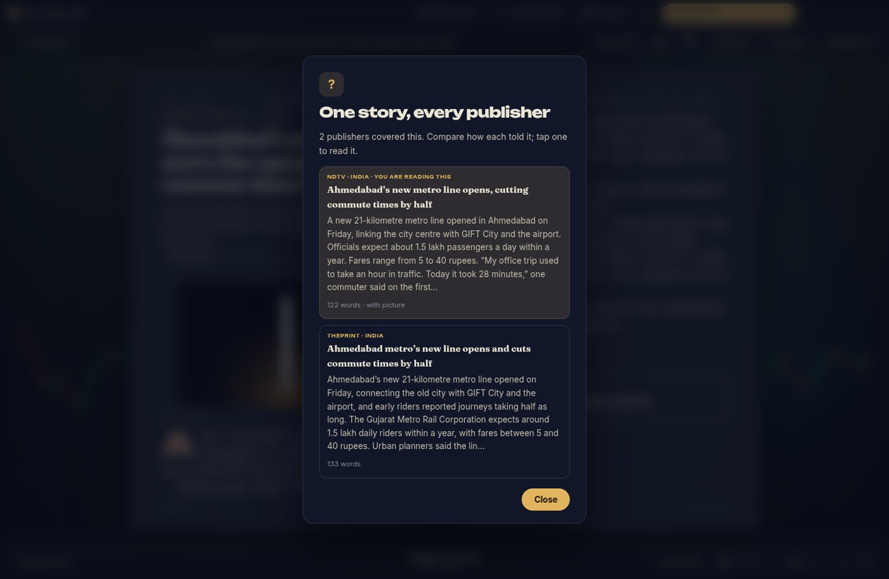 |

<sub>Screenshots come from the automated tests, which use made-up stories and placeholder pictures.</sub>

## What makes it different

- **Nine desks, one paper**: Everything gives every desk with news at least one page and more pages to what you read most. A topic paper (say, Finance) is that desk alone, with its own masthead and backdrop.
- **One brain across topics**: what you open, finish and rate anywhere teaches the same on-device model. About one story in five is deliberately something different, so it never traps you in a bubble.
- **Only free stories**: paywalled articles are detected and skipped.
- **One story, every publisher**: when several outlets cover the same news, compare how each told it, side by side.
- **A real paper**: Page 3 people, a quiz built from the week's stories, did-you-know facts, home-made memes, great telescopes and your own sky when Astronomy is in the paper.

## How it works

Everything runs on your laptop. The only part allowed to touch the internet is a private fetcher with no cookies, no IDs and no referrer; the windows you read in cannot reach the internet at all.

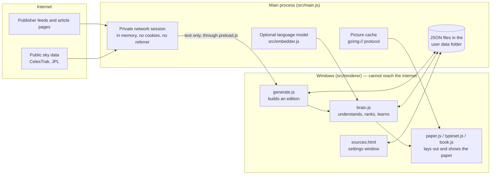

### Printing a paper, step by step

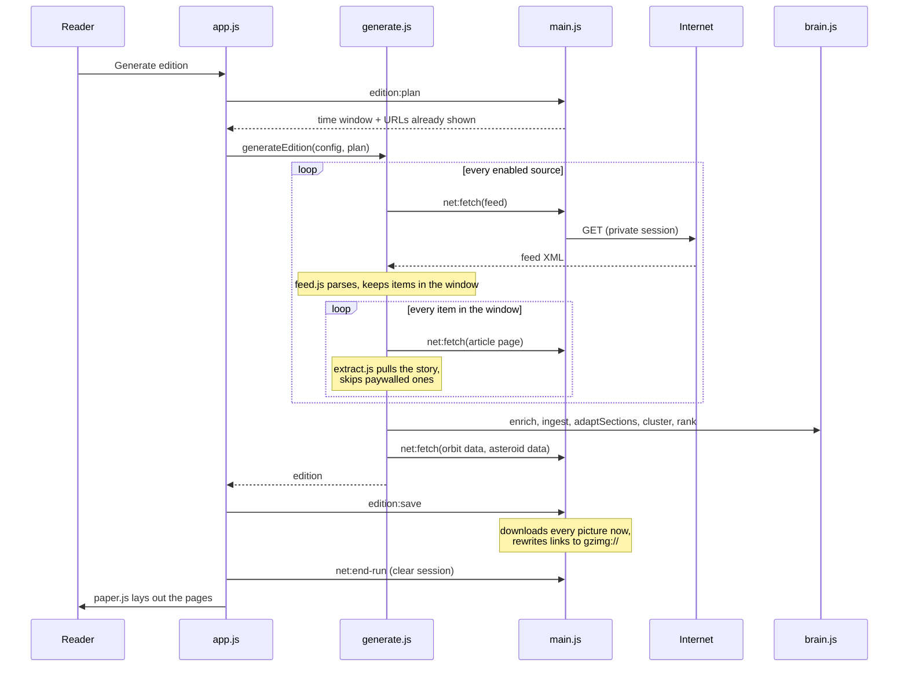

### What it stores (all on your laptop)

<details>
<summary>Data model: entity-relationship diagram</summary>

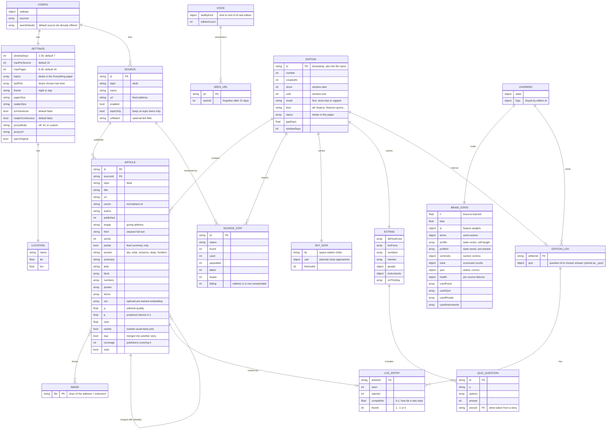

</details>

| 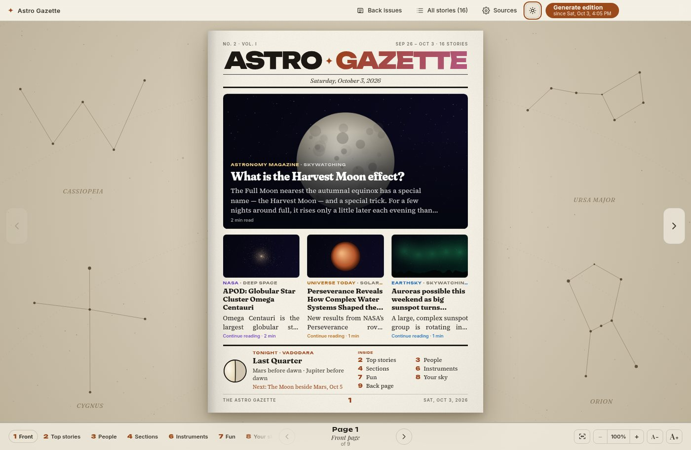 | 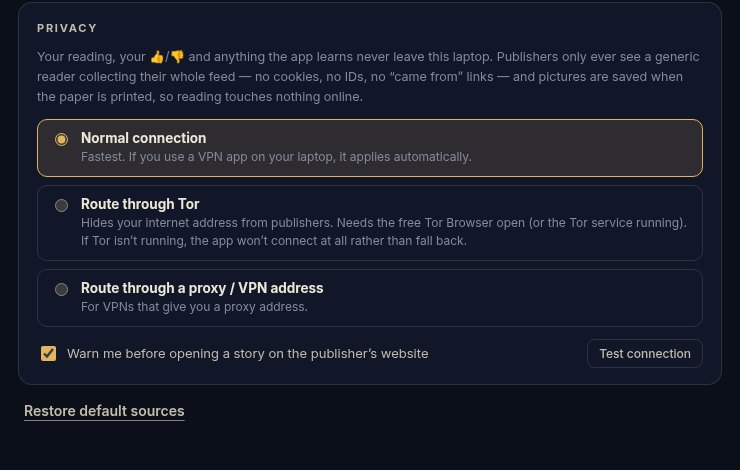 |
|---|---|

More detail: [Architecture](docs/ARCHITECTURE.md) · [Data model](docs/DATA-MODEL.md) · [Privacy design](docs/PRIVACY.md) · [How it learns](docs/LEARNING.md)

## Upcoming extensions

The Daily Orbit is young. These are on the roadmap:

- **Phone and tablet apps.** Today it runs on Windows desktops only. An Android version can reuse about 85% of the code; iOS and macOS/Linux builds would follow.
- **Sync between your devices, privately.** Each device learns on its own today. Planned: an encrypted export/import of your taste, with no cloud account.
- **One-click installer and auto-update.** Today the first run needs Node.js and downloads its runtime; a signed installer would remove that step.
- **Scheduled morning paper.** Print automatically at a time you choose, ready when you wake up.
- **More languages.** Hindi, Gujarati, Marathi and other Indian-language desks, and reading aloud in them.
- **Live data boxes.** Market indices, match scores and weather alongside the news, from free public sources.
- **Smarter writing on the page.** Today summaries are extracted from the article itself; a small on-device model could write short, neutral summaries and headlines.
- **Source health and discovery.** Suggest good free sources for a new desk, and warn when a publisher starts paywalling.
- **Shareable editions.** Send a page or a whole paper to a friend as a PDF or link, without revealing your taste.
- **Accessibility, further.** Full screen-reader support (every page and control labelled), a high-contrast mode, adjustable reading voice and speed, and a dyslexia-friendly font option.

## Documentation

| Document | About |
|---|---|
| [Architecture](docs/ARCHITECTURE.md) | The parts of the app and how an edition is printed |
| [Data model](docs/DATA-MODEL.md) | ER diagram of everything stored on disk |
| [Privacy design](docs/PRIVACY.md) | What stays local, what a publisher can see, how it is enforced |
| [How the paper learns](docs/LEARNING.md) | The on-device model and how to check it |
| [Development](docs/DEVELOPMENT.md) | Run from source, tests, building the installer, release steps |
| [Changelog](CHANGELOG.md) | What changed in each version |
| [Contributing](CONTRIBUTING.md) | Ground rules for changes |

## Getting started

You need **Node.js** (the LTS version from https://nodejs.org) — version 20 or newer.

| Want to… | Do this |
|---|---|
| Just run it | Double-click **`Run Daily Orbit.bat`** (first run installs Electron, ~1 min) |
| Install it like a normal app | Double-click **`Build Windows Installer.bat`**. When it finishes, the `dist` folder has `DailyOrbit-Setup-<version>.exe` (installer with Start-menu + desktop shortcuts) and `DailyOrbit-Portable-<version>.exe` (single file, no install) |

Or from a terminal: `npm install` then `npm start`.

## How the edition window works

The app remembers when you last printed an edition.

- **First edition** → stories from the past 7 days.
- **Last edition was less than 7 days ago** → everything published since that edition. Print today and again tomorrow, and tomorrow's paper holds only the new day's stories.
- **Away more than 7 days** → only the last 7 days. The paper tells you how long you were away.

If nothing is new, you get "You're all caught up" and your window isn't used up. If every source is unreachable (no internet), nothing changes either. The 7 days can be changed in **Sources → Edition settings** (1–30).

## Sources

Click **Sources** in the title bar. Sources are grouped by desk: pick a desk tab to see, switch on/off, **Test**, **Edit** or **Remove** its publishers, and choose whether that desk is part of the **Everything** paper.

- **Add a source**: choose its desk, paste a feed URL *or just the site's homepage* — the app finds the RSS feed for you.
- **Topic only** filter: for publishers that cover everything, keeps only the stories that match the source's desk.

About 70 sources come pre-filled, 49 of them switched on, from publishers such as Al Jazeera, BBC, The Guardian, NPR, NDTV, ThePrint, Scroll, The Hindu, Mint, TechCrunch, Ars Technica, ScienceDaily, Quanta, ESPNcricinfo, Sky Sports, NASA, ESA, ESO and Sky & Telescope. The full list is in `src/default-sources.js`. Feeds were checked on 10 Oct 2026; a few well-known ones could not be checked from the build machine and are marked there. The paper's back page lists any source that could not be reached.

## Paywalls and full text

For each story in the window the app uses the feed's full text when the feed provides it (NASA does). Otherwise it opens the article page and extracts the story, stripping menus, ads, share buttons and "related" links. A story is **skipped** if:
- the publisher marks it subscriber-only (`isAccessibleForFree: false` / locked content tier), or
- the page shows a paywall and only a short teaser is public.

If a free page can't be read (some sites block automated readers), the feed's summary is shown instead with a link to the original. The footer of each edition lists, per source, how many stories were used, how many paywalled stories were skipped, and which sources couldn't be reached.

## The paper

1. **Front page**: the lead story, the next ones, tonight's Moon for your city, and an index.
2. **Top stories**: the best of the edition, each with its opening paragraphs, plus "by the numbers".
3. **Page 3, People**: a famous name from the desks in this paper (born this week when possible), people quoted in the news, and a hall of fame.
4. **Desk pages**: in the Everything paper, each desk gets its own colour-coded pages, in the order you read them most; in a topic paper, that desk's sections.
5. **Eyes on the sky** and **Your sky**: when Astronomy is in the paper.
6. **Fun & games**: a 5-question quiz (some questions come from this edition's stories), did-you-know, fun facts and two home-made memes, mixed across the desks.
7. **Back page**: stories that didn't fit as briefs, sources, and what the paper has learned.

The paper grows with the news, up to 24 pages (8–30 in **Sources → Edition settings**). **All stories** lists everything the edition collected.

**Turning pages.** Only the arrow buttons or the **← / →** keys turn pages. Scrolling, dragging, Space and Page Up/Down never do (a setting brings them back). **Home / End** jump to the first/last page.

**Moving around a page.** **↑ / ↓** move the page up and down when it is zoomed or in fit-to-width; they never turn pages.

**Zoom.** **− / +** or Ctrl+scroll, **0** to reset, **W** for fit-to-width. **A− / A+** change the type size.

**Reading a story.** Click any story. **👍 / 👎** teach the paper, **Why this?** explains the pick, and the **continuous reading** switch (the four-squares button) lays the story out as two-page spreads you scroll through. **Esc** returns to the paper.

## How it learns (all on your laptop)

- It learns across every desk: one model for all topics, plus a preference for each topic that the Everything paper uses to share out its pages.
- It notes which stories you open, how far you read, which you skip, your 👍/👎 and your quiz answers.
- From that it trains a small model of your taste and uses it to order the next edition. About one story in five is deliberately outside your usual taste.
- It also learns astronomy vocabulary from every article it downloads, so it can tell that two stories are about similar things even when the words differ.
- Quiz difficulty follows your score. Sections, page count and layout follow the content.
- If a publisher moves its feed, the app looks for the new address on the publisher's home page and updates the source itself.
- **Sources → What your paper has learned** shows what it believes, with a button to erase it.

**Is the model doing its job?** Three places to look, all on your laptop:

- **Scorecard** (Sources → What your paper has learned). After each edition the paper compares what it predicted with what you actually did: how often you opened the stories it ranked high against the ones it ranked low. If the first number is not clearly above the second after a few editions, it is not learning.
- **Check the model now** (same card). A language test (does it know that "lunar eclipse" is closer to "Moon in Earth's shadow" than to "rocket launch"?) and a taste test (does it score your 👍 stories above your 👎 stories?). It also says whether the pre-trained model or the self-taught one is in use.
- **Why this?** in the reader. For any story: the model's score, and what counted for and against it.

**Pre-trained language model (optional, free).** The two `.bat` files download a small open model (all-MiniLM-L6-v2, about 25 MB) into the `models` folder the first time, and install the library that runs it. With it, the paper understands what a story is about from the first edition. It runs only on your laptop, and the app is locked so it cannot download anything for the model while running. If the download fails or the model can't load, the app uses its built-in self-taught model instead; **Sources → What your paper has learned** says which one is in use. To retry the download: `npm run fetch-model`.

## Your location and the sky page

Set your city (or coordinates) in **Sources → Your location**. Mumbai is the default. The app deliberately does not use Windows' own location service: that works by sending nearby Wi-Fi details to an online service, which would break the rule that nothing about you leaves the laptop. All sky calculations run on your laptop; the location is never sent anywhere and is never looked up online. Space-station passes and asteroid flybys use two public data files (the same for everyone) downloaded when an edition is printed, so they refresh with each new edition.

## Privacy

- The app's windows cannot reach the internet. Only the fetcher can, through a private session with no cookies, no stored IDs and no referrer.
- Every story in the date window is downloaded, not just the ones you read; pictures are saved at print time. Reading touches nothing online.
- Fonts and all code libraries are bundled.
- Optional: **Sources → Privacy → Route through Tor** hides your internet address from publishers (needs Tor Browser running; if Tor is unreachable the app does not connect).
- Opening a story on the publisher's site asks first, because that is an ordinary web visit.

## Where your data lives

`%APPDATA%\The Daily Orbit\` — `config.json` (sources, settings, location), `state.json` (last edition time, stories already shown), `editions\` (back issues), `images\` (saved pictures), `learning.json` (reading log and everything learned), `article-cache.json` (stories read in the last 8 days, so a second paper is quick). Delete `state.json` to start fresh with a 7-day edition.

## Project layout

```
src/main.js              Windows, storage, private network session, picture cache, Tor/proxy
src/plan.js              The catch-up window rule
src/migrate.js           Upgrades saved sources when defaults change
src/default-sources.js   Default publisher list
src/preload.js           Bridge between the windows and main process
src/embedder.js          Optional pre-trained language model (runs locally, never downloads at run time)
scripts/fetch-model.js   Build-time download of that model into ./models
src/renderer/
  app.js        Controller: printing, reading log, thumbs, quiz, zoom, continuous reader
  generate.js   Builds an edition: fetch → extract → understand → rank → extras
  brain.js      Summaries, facts, quotes, story merging, ranking, on-device learning
  extras.js     Quiz, did-you-know, memes, Page 3, instruments, on this day
  content.js    Bundled library: people, instruments, facts, quiz bank, dates, cities
  skyevents.js  Location-based sky calculations
  topics.js     The desks: colours, sections, topic filters
  content-topics.js  People, facts, quiz and memes for every desk
  paper.js      The paper layout
  typeset.js    Book-reader pagination and shared helpers
  book.js       Page-turn engine, zoom, fit-to-width
  backdrop.js   Rotating painted sky backgrounds
  feed.js, extract.js   Feed parsing, article extraction, paywall detection
  sources.html/.css/.js Sources, location, learning and privacy window
  vendor/       astronomy-engine and satellite.js (MIT licences included)
  fonts/        Bundled fonts (SIL Open Font Licence files included)
```

## Tests

```
node test/brain.test.js     the learning model
node test/sky.test.js       sky calculations
node test/run.js            the whole app in a browser, with a stand-in for the network
```

The first two need only Node. The third needs Playwright (`npm install --no-save playwright && npx playwright install chromium`); screenshots go to `test/shots/`.

## Licence

MIT (see `LICENSE`). Bundled fonts are under the SIL Open Font Licence and the two astronomy libraries under MIT; their licence files sit next to them.
