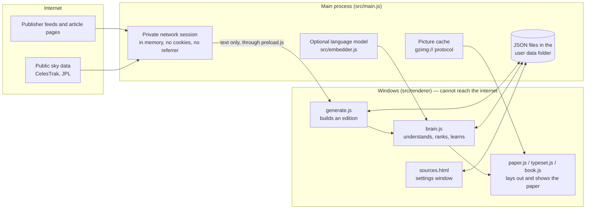
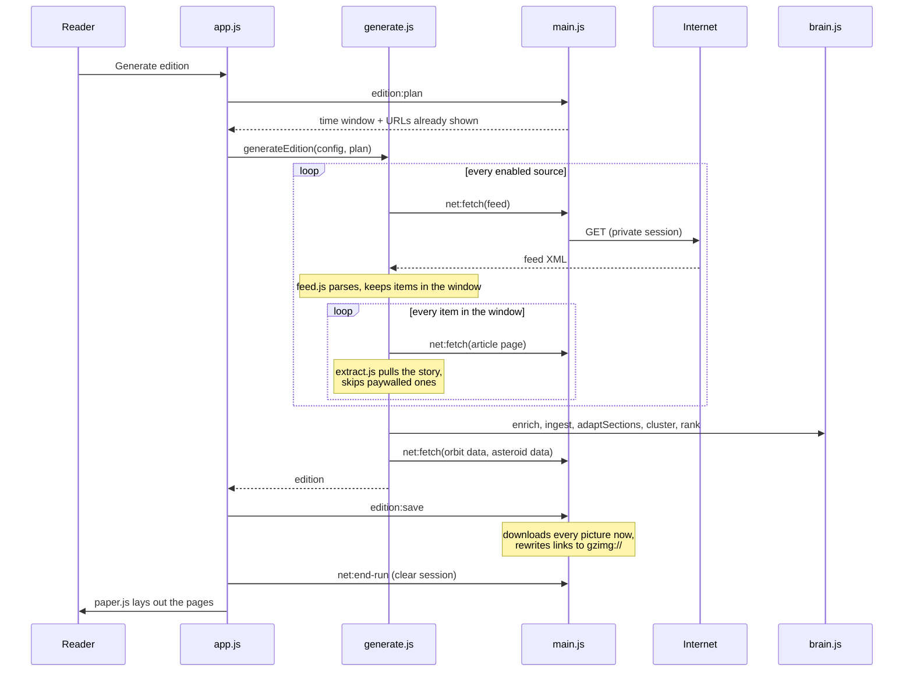

# Architecture

The Astro Gazette is an Electron app with no server, no database and no accounts. Everything runs on the reader's laptop. The design follows one rule: **information may flow in from the internet, but nothing about the reader flows out.**

## The three parts

| Part | Files | Job |
|---|---|---|
| Main process | `src/main.js`, `plan.js`, `migrate.js`, `default-sources.js`, `embedder.js` | Windows, storage, the only code allowed to use the network, picture cache, optional Tor/proxy, optional pre-trained model |
| Bridge | `src/preload.js` | The short list of calls a window may make (`window.api`). Windows run sandboxed with context isolation |
| Windows | `src/renderer/*` | Everything the reader sees, and all the thinking: parsing, extraction, ranking, learning, layout, sky sums |

## How an edition is printed

Two points matter for privacy. Every story in the window is downloaded, not only the ones that end up on a page or get read, so the traffic says nothing about taste. And all pictures are fetched at print time, so reading an edition later makes no network requests at all.

## The edition window

`src/plan.js` holds the rule:

| Situation | Window |
|---|---|
| First edition | Last 7 days |
| Last edition less than 7 days ago | Everything since that edition |
| Last edition more than 7 days ago | Last 7 days only |

The 7 is a setting (1–30). URLs already considered are remembered for 21 days so a story never appears twice.

## Renderer modules

| Module | Job |
|---|---|
| `feed.js` | RSS and Atom parsing, feed discovery from a home page |
| `extract.js` | Readability-style article extraction, paywall detection, HTML cleaning |
| `generate.js` | Runs the whole pipeline; repairs sources whose feed address has moved |
| `brain.js` | Summaries, facts, numbers, quotes, story merging, ranking, on-device learning. Pure functions, also runs under Node for tests. See [LEARNING.md](LEARNING.md) |
| `extras.js`, `content.js` | Quiz, did-you-know, memes, people, instruments, on-this-day, from the edition plus a bundled library |
| `sky.js`, `skyevents.js` | Moon, planets, eclipses, conjunctions, meteor showers, satellite passes, asteroid flybys for the chosen location |
| `paper.js` | Chooses pages and fits stories into them (up to 24 pages by default) |
| `typeset.js` | Paginates a story for the reader |
| `book.js` | Page-turn engine, zoom, fit-to-width |
| `backdrop.js` | Painted sky backgrounds that rotate |
| `app.js` | Controller: printing, reading log, ratings, quiz, continuous reader |
| `sources.js` | Settings window: sources, location, learning, privacy |

## Layout

Pages are built as HTML and then measured. `paper.js` places cards, then shortens text line by line until every card fits its slot, so nothing is cut off at any window size. Section pages are added while there are stories and the page limit allows.

## Network rules

Enforced in `src/main.js`:

- Windows use the default session, which blocks every `http`, `https` and `ws` request. Their content security policy is `default-src 'none'`.
- Only the main process fetches, through `session.fromPartition('gazette-fetch')`: in memory, no cache, cookies and `Set-Cookie` stripped, `Referer` and `Origin` removed, a generic user agent.
- Pictures are stored on disk under a hash of their address and served by the app's own `gzimg://` protocol.
- With Tor or a proxy selected, the session fails closed: if the proxy is unreachable, nothing connects.
- Fonts and libraries are bundled. The optional language model is downloaded once at install time and can never be fetched while the app runs.

More in [PRIVACY.md](PRIVACY.md).

## Third-party code

| What | Where | Licence |
|---|---|---|
| astronomy-engine | `src/renderer/vendor/astronomy.min.js` | MIT |
| satellite.js | `src/renderer/vendor/satellite.min.js` | MIT |
| Fonts: Playfair Display, Source Serif 4, Inter, UnifrakturMaguntia, Unbounded, Fraunces | `src/renderer/fonts/` | SIL OFL |
| @huggingface/transformers 3.8.1 and all-MiniLM-L6-v2 (optional) | installed by npm / `scripts/fetch-model.js` | Apache-2.0 |
