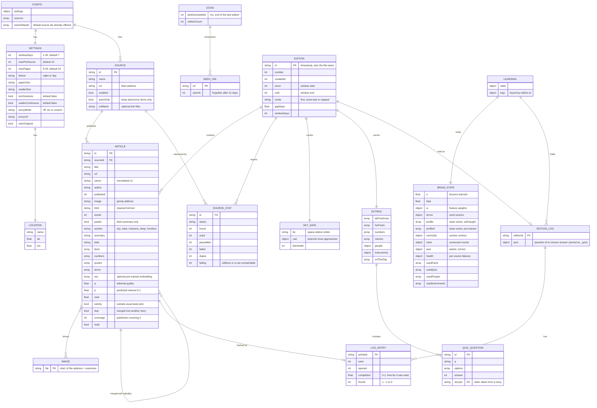

# Data model

There is no database. The app keeps a few JSON files in the per-user data folder (`%APPDATA%\The Astro Gazette\` on Windows). The diagram shows what they hold and how the pieces relate.

## Files on disk

| File | Holds | Written when |
|---|---|---|
| `config.json` | CONFIG, SETTINGS, LOCATION, SOURCE | Settings or sources change |
| `state.json` | STATE, SEEN_URL | An edition is printed |
| `editions/<id>.json` | One EDITION with its ARTICLEs, SOURCE_STATs, SKY_DATA and EXTRAS. The newest 30 are kept | An edition is printed; a story is first opened |
| `images/<sha1>.<ext>` | IMAGE. Pictures no remaining edition uses are deleted | An edition is printed |
| `learning.json` | LEARNING, BRAIN_STATE, EDITION_LOG, LOG_ENTRY | While reading |

Files are written to a temporary name and then renamed, so a crash never leaves a half-written file.

## Notes

- Things computed for display are not stored: page layout, and sky events for the chosen location (worked out from SKY_DATA plus LOCATION each time).
- `learning.json` is the only file about the reader's behaviour. **Sources → Erase what it learned** deletes it.
- Deleting `state.json` makes the next edition a fresh 7-day one.
- Old `config.json` files are upgraded by `src/migrate.js`: new default sources are offered once, moved feed addresses are corrected, removed sources stay removed.
